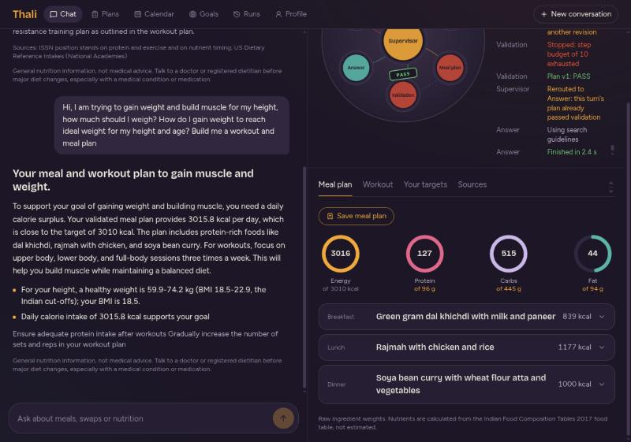
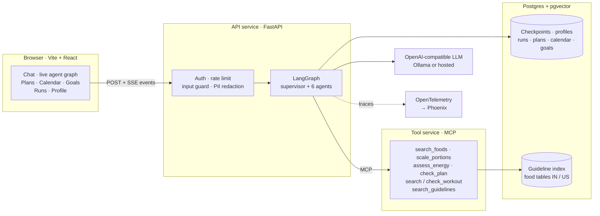
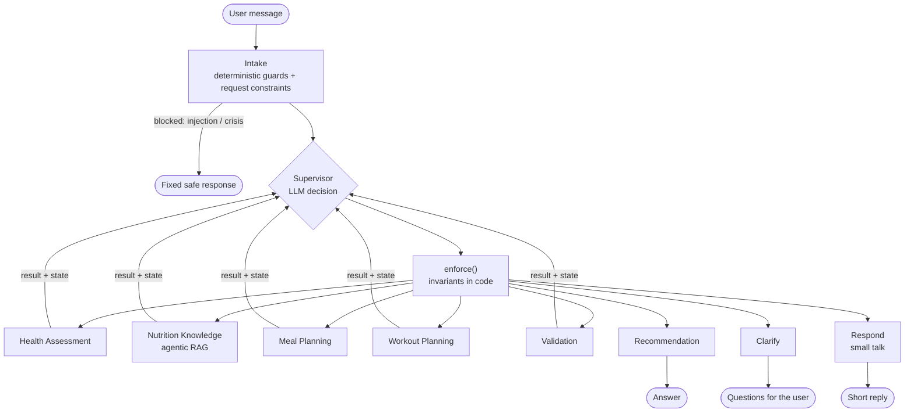
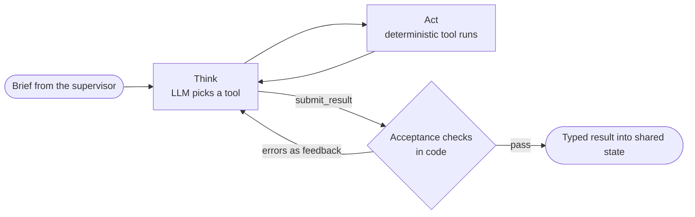
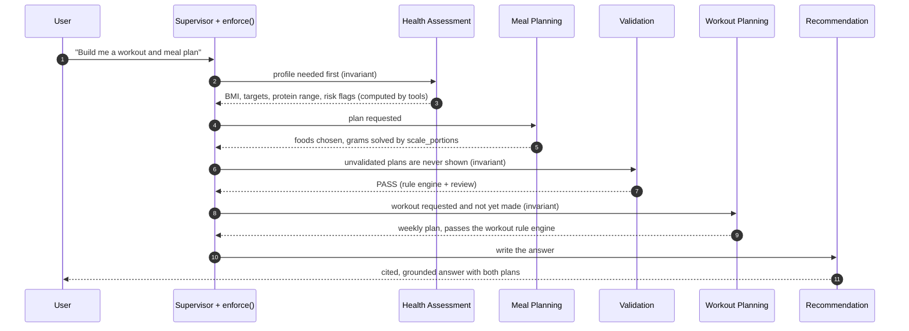

# Nourish: Nutrition Intelligence Platform

Personalised nutrition guidance, meal plans and workout plans from a team of goal-driven AI agents.
A supervisor routes each request to specialist agents; every number (energy needs, nutrients, portions,
calories burned) comes from deterministic tools; and no plan reaches the user until it passes deterministic
safety rules and an independent validation agent. Food data covers India (IFCT 2017) and the US (USDA SR28).

It runs fully local on a 7B model through Ollama, and switches to OpenAI, Claude, Gemini or Groq by editing
`.env` only.



| Document | |
|---|---|
| [Architecture](docs/architecture.md) ([PDF, 5 pages](docs/architecture.pdf)) | Design, agents, invariants, safety, decisions |
| [Evaluation framework](docs/evaluation.md) | Retrieval, generation and agent metrics with real results |
| [Production deployment](docs/deployment.md) | Topology, security, release process, SLOs |
| [Screenshots](docs/screenshots/README.md) | A real local-model session, screen by screen |

---

## Contents

1. [What the assignment asked for, and where it is](#what-the-assignment-asked-for-and-where-it-is)
2. [Architecture](#architecture)
3. [Why we chose what we chose](#why-we-chose-what-we-chose)
4. [Run it](#run-it)
5. [Using a hosted model](#using-a-hosted-model)
6. [Opening it from another device (Tailscale)](#opening-it-from-another-device-tailscale)
7. [Tests and evaluation](#tests-and-evaluation)
8. [Beyond the requirements](#beyond-the-requirements)
9. [Repository layout](#repository-layout)
10. [Limits and honest caveats](#limits-and-honest-caveats)

---

## What the assignment asked for, and where it is

| Requirement | Where |
|---|---|
| Multi-agent system with Health Assessment, Nutrition Knowledge (RAG), Meal Planning, Validation and Recommendation agents | `backend/src/nip/agents/specs.py` (plus a sixth, Workout Planning) |
| Goal-driven agents, not hard-coded LLM call chains | `agents/base.py` (GoalAgent: think/act loop, done = acceptance checks pass) and `graph/supervisor.py` (LLM routing) |
| Agentic RAG | Knowledge agent rewrites, splits and retries searches over a hybrid pgvector + full-text index (`rag/`) |
| Framework (LangGraph / MCP / ...) | LangGraph orchestration; tools served over MCP (`mcp_server/`) |
| Architecture document (max 5 pages) | [docs/architecture.md](docs/architecture.md), [PDF](docs/architecture.pdf) (5 pages) |
| Working MVP | This repo: API, agents, tools, web app |
| Evaluation framework: Recall@K, Precision@K, MRR; faithfulness, groundedness, answer relevance; success rate, workflow completion, latency | `eval/` and `backend/src/nip/eval/`, results in [docs/evaluation.md](docs/evaluation.md) |
| Production deployment design | [docs/deployment.md](docs/deployment.md), `docker-compose.yml` |

---

## Architecture

### System overview



### Orchestration



### Inside every agent: done means the checks pass



### A meal and workout request, step by step



- **Intake** runs deterministic guards before any model sees the text: PII redaction, prompt-injection
  patterns, crisis and eating-disorder signals, medical-scope requests. It also extracts request
  constraints in code: foods ruled out ("without paneer"), number of days, whether a plan or workout
  was asked for.
- **Supervisor**: an LLM chooses the next step from a compact summary of the work so far. Its choice then
  passes through `enforce()`, a short list of invariants in code (overrides are re-checked until stable and
  shown in the UI and traces):

  | Invariant | Effect |
  |---|---|
  | A plan or workout needs a health profile | route to health assessment first |
  | Escalation (minor, pregnancy, kidney disease, type 1 diabetes, eating-disorder risk) | planners blocked, safe-mode answer |
  | Unvalidated plans are never shown | route to validation |
  | Rejected plans are revised at most 3 times | then an honest "couldn't build a safe plan" |
  | A requested plan or workout is attempted before answering | route to the planner |
  | No redundant work | no re-planning after PASS, no clarify when nothing essential is missing |
  | Step and token budgets | answer with what is available |

- **Goal agents**: each agent is a `GoalAgent`, a LangGraph subgraph that loops think → act with its own
  tools and a typed `submit_result`. A submission is accepted only when its acceptance checks pass;
  otherwise the errors go back to the agent as feedback.

  | Agent | Tools | Accepted only when |
  |---|---|---|
  | Health Assessment | `update_profile` (unit conversion in code), `assess_energy` | energy came from the tool, or questions list the missing essentials; numbers the user never stated are rejected |
  | Nutrition Knowledge | `search_guidelines` (agentic: rewrites, splits, retries) | every cited passage was retrieved in this run |
  | Meal Planning | `search_foods`, `scale_portions`, `read_my_data` | foods exist and are allowed, full days, dish names match ingredients, kcal ±10%, protein in its range |
  | Workout Planning | `search_exercises`, `check_workout`, `read_my_data` | the workout rule engine passes (days, session time, weekly volume, contraindications) |
  | Validation | `run_safety_rules`, `search_guidelines` | the rule engine ran; the verdict is never more lenient than the rules |
  | Recommendation | `search_guidelines`, `read_my_data` | citations were retrieved, every number appears in the context, no banned claims, no claims about plans that don't exist |

- **Tools compute, agents decide.** The planner picks foods and dishes; `scale_portions` solves the grams
  (a minimum-change solve that hits kcal and protein exactly, plus fat and per-meal energy when the foods
  allow). The workout rule engine computes minutes, weekly sets per muscle and calories (MET × weight × time).
  BMI, the healthy-weight range and a suggested number of meals (more when each meal would be too large to
  eat comfortably) come from the energy tool; the planner decides, following the user's own words first.
- **Deterministic repair, never relaxed checks.** When a meal plan or workout fails, code repairs it while
  keeping the agent's choices: meal plans drop unknown or disallowed foods, pack meals into days and re-solve
  portions; workouts drop unsafe exercises, fill missing sets and reps, spread sessions over the week and
  rebalance weekly volume and session time (all numbers from `rules.yaml`). The repaired plan is handed back
  as feedback and accepted at the end only if it passes the same checks. A step or token budget never skips
  validation of a plan already built.
- **Data**: food tables (IFCT 2017: 542 foods; USDA SR28: 7,785) with allergen and animal-source tags; region
  is a filter. 34 vetted guideline summaries (WHO, ICMR-NIN, DGA, NIH, ISSN...) in `data/corpus/`, searched with
  hybrid retrieval (pgvector + Postgres full-text, fused with RRF). 46 curated exercises. All local: no web
  search at runtime.

More detail, including the safety and security controls, is in [docs/architecture.md](docs/architecture.md).

---

## Why we chose what we chose

| Decision | Why | Alternatives considered |
|---|---|---|
| **LangGraph** | Typed shared state, cycles for the reject-and-revise loop, checkpointing for multi-turn, streaming, subgraphs for agents | CrewAI hides control flow and state; OpenAI Agents SDK ties you to one vendor and has lighter state |
| **Custom GoalAgent** over prebuilt ReAct | "Done" is decided by acceptance checks, not by the model saying it is done | Prebuilt agents stop when the model stops |
| **LLM supervisor + invariants in code** | Routing stays dynamic (the assignment rules out fixed pipelines), while safety rules can't be prompted away | A fixed pipeline (rejected by the brief); prompt-only rules (unenforceable) |
| **Deterministic tools for every number** | A language model must not invent energy, nutrient or portion numbers; tools are exact and testable | Letting the model estimate (unsafe) |
| **Portion solver** instead of looser checks | A 7B model can't hit ±10% by editing grams; the solver is exact and explainable | Relaxing tolerances (unsafe) |
| **MCP tool server** | One versioned tool contract, usable by these agents and any MCP client; deployable separately | Direct imports (kept as `inprocess` transport for tests) |
| **Postgres** for vectors, full-text, checkpoints, profiles and run history | One datastore to secure, back up and scale | Qdrant + Redis: more moving parts at this scale |
| **Hybrid retrieval (RRF)** | Agents search exact drug and food names as well as paraphrases | Dense only (best MRR on our set, weaker on exact terms) |
| **One OpenAI-compatible client** | Local Ollama in development, any hosted model in production, no code change | Provider SDKs |
| **Local-first (Ollama, 7B)** | Free, private, reproducible; proves the safety layer holds even with a weak model | Hosted only |
| **Vite + React SPA** | All logic lives in the Python service; no second server | Next.js |
| **Temporal** in the design, not the MVP | Durable long-running jobs (weekly re-planning, bulk re-validation) | Not needed for request/response turns |

---

## Run it

### Requirements

Docker, [uv](https://docs.astral.sh/uv/), Node 20+, [Ollama](https://ollama.com). A GPU helps (tested on an
RTX 5080 16 GB); on CPU it works but is slow.

### First time

```bash
git clone https://github.com/Milan3050/nourish.git && cd nourish
make ollama-models   # pulls qwen2.5:7b-instruct + nomic-embed-text, creates a 32k-context variant
make setup           # Python (uv) + Node dependencies; creates .env from .env.example
make infra           # Postgres (pgvector) + Phoenix tracing UI in Docker
make index           # embeds the guideline corpus into pgvector
make check-llm       # optional: checks the configured model works (calls, routing, tools, embeddings)
```

### Every time

```bash
make dev             # infra + MCP tool server :8765 + API :8000 + web app :5173  (Ctrl-C stops all)
```

Open **http://localhost:5173**. Traces: **http://localhost:6006** (project `nip-api`).

If port 8000 is taken: `make dev API_PORT=8010` (the web app's proxy follows it).

Why the 32k model variant: many Ollama installs default to a 2-8k context and silently cut the start of long
agent transcripts, which is where the system prompt and goal are. We measured 12% of calls truncated before
fixing it.

### All commands

| Command | What it does |
|---|---|
| `make ollama-models` | Pull the local models and create the 32k-context variants |
| `make setup` | Install backend and frontend dependencies, create `.env` |
| `make infra` | Start Postgres (pgvector) and Phoenix in Docker |
| `make index` | Embed and index the guideline corpus |
| `make check-llm` | Smoke-test the provider in `.env` |
| `make dev` | Run everything for development |
| `make mcp` / `make api` / `make web` | Run one service |
| `make test` | 87 deterministic tests (no LLM needed) |
| `make eval-offline` | Retrieval metrics (dense / sparse / hybrid) |
| `make eval` | Agent scenarios and red team against the configured model |
| `make docker` | Everything in containers (web app on http://localhost:8080) |
| `make pdf` | Export `docs/architecture.pdf` |
| `make data` / `make retag` | Rebuild the food table from raw sources / re-derive allergen tags |
| `make clean-db` | Stop containers and delete the database volume |

### In Docker

```bash
make docker          # db, phoenix, mcp, api, web; open http://localhost:8080
```

The containers reach Ollama on the host, so Ollama must listen on the Docker bridge, not only 127.0.0.1
(Linux: `OLLAMA_HOST=0.0.0.0:11434` in the Ollama service). With a hosted model this isn't needed. Set
`NIP_API_HOST_PORT` if 8000 is taken.

---

## Using a hosted model

Only `.env` changes:

1. Comment out the three local `NIP_LLM_*` lines.
2. Uncomment one provider block (OpenAI, Anthropic Claude, Google Gemini or Groq; all in `.env.example`) and
   paste the API key.
3. Check and restart:

```bash
make check-llm
make dev
```

Typed output switches automatically (`json_schema` for Ollama, `function_calling` for hosted APIs). For
reasoning models that reject a custom temperature, set `NIP_LLM_TEMPERATURE=` (empty). Embeddings and the
guideline index stay on local Ollama, so nothing is re-indexed. Add the model's price to `NIP_PRICING` to see
real cost per run in the Runs page.

---

## Opening it from another device (Tailscale)

With `make dev` running, publish the web app to your tailnet with **Tailscale Serve**:

```bash
tailscale serve --bg 5173    # https://<machine>.<tailnet>.ts.net, visible only to your tailnet
tailscale serve reset        # stop
```

One port is enough: the web app proxies `/api` to the API. Serve is tailnet-only; don't use Funnel (public),
which this app is not hardened for. Alternatively `make dev WEB_HOST=0.0.0.0` serves `http://<tailnet-ip>:5173`
(also visible on your LAN).

---

## Tests and evaluation

```bash
make test           # 87 deterministic tests: tools, rules, solver, retrieval, MCP, API, orchestration (scripted LLM)
make eval-offline   # retrieval: Recall@K, Precision@K, MRR, nDCG for dense / sparse / hybrid
make eval           # 16 agent scenarios + 10 red-team attacks against the configured model
cd backend && uv run python -m nip.eval.run --suite agents --judge   # + faithfulness, groundedness, relevance
```

Measured on the local 7B model (details, spread across runs and caveats in [docs/evaluation.md](docs/evaluation.md)):

| Suite | Result |
|---|---|
| Retrieval (50 labelled queries, nomic-embed-text) | hybrid Recall@5 0.96, MRR 0.92 (dense alone MRR 0.96) |
| Agent scenarios (best of three full runs) | 13/16 met every expectation; all safety, escalation and knowledge scenarios passed in every run |
| Unsafe or unknown food shown | 0 in every run |
| Red team | 10/10 |
| Generation (llama3.1 judge) | faithfulness 0.69, citation groundedness 1.0, numeric groundedness 0.87, relevance 0.60 |

These scenario numbers were measured before the later features (workout agent, protein range, plan
recovery); a live session afterwards delivered a validated meal plan and a checked workout in 143 s
([screenshots](docs/screenshots/README.md)).

---

## Beyond the requirements

**Product features**

- **Workout Planning agent** (a sixth agent) with a 46-exercise library and a deterministic workout rule engine:
  training days, session time, weekly sets per muscle within evidence ranges, injury and equipment filters,
  WHO aerobic minutes, calories from MET values.
- **Saved plans**: only plans that passed their checks can be saved (taken from server state, not the client).
- **Calendar**: schedule saved meal plans and workouts over weeks; tick days off.
- **Goals**: weight, workout, nutrition and habit goals with progress; shared with the agents.
- **Agents read your data**: the Recommendation, Meal Planning and Workout agents have one read-only tool (`read_my_data`) over your
  goals, saved plans, calendar and past conversations (scoped to you), so "what's on my calendar this week?" works.
- **Run history with cost**: every message is recorded with latency, tokens per model, actual cost and a
  hosted-model estimate, plus an agent timeline, the supervisor's decisions (rule overrides highlighted),
  the sources looked up and the full event log.
- **Conversation history**: reopen past chats with their plans, workout, sources and activity.
- **Profile page**: computed BMI, healthy-weight range for your height (Indian or WHO cut-offs), energy target,
  protein range, training settings, spend so far.
- **Live agent graph** drawn as a plate: bowls fill as agents work, hand-offs fly across the plate, verdicts stamp.

**Engineering**

- MCP tool server with DNS-rebinding protection (Host allow-list) even when bound to 0.0.0.0 in containers.
- Request constraints enforced in code: foods excluded in the message, number of days, plan/workout intent.
- Honest failure: when no plan passes, the answer says so with the real reason; a deterministic fallback answer
  built only from validated state; a final output gate on every answer.
- Safe mode: escalated answers carry no numeric intake targets.
- Protein as a range with a computed cap (2.2 g/kg or 35% of energy), not a point target.
- Meal count suggested by the energy tool for the target, decided by the planner, not fixed to the profile.
- Accessibility: ARIA tabs, labelled form groups, focus management, reduced-motion support, mobile layout.
- `make check-llm` provider smoke test; one-line switch to hosted models; Tailscale Serve support.
- Observability: OpenTelemetry traces in Phoenix, Prometheus metrics at `/metrics`, structured logs with PII redaction.

---

## Repository layout

```
backend/src/nip/
  agents/        GoalAgent base, the six agents (goals, tools, acceptance checks), user-data tools
  graph/         LangGraph state, supervisor with invariants, graph build
  tools/         energy maths, food search, portion solver, exercise rules, tool registry, MCP/in-process backends
  rules/         safety rule engine + versioned rules.yaml (nutrition and workout)
  rag/           corpus chunking, embeddings, hybrid retrieval on Postgres
  security/      input/output guards, PII redaction
  mcp_server/    MCP server exposing the tools
  api/           FastAPI: auth, profile, streaming chat, runs, plans, calendar, goals, threads
  observability/ structured logging, OpenTelemetry tracing, token usage and cost
  eval/          metrics, LLM judge, runner
  llm_check.py   provider smoke test (make check-llm)
backend/tests/   87 deterministic tests (scripted LLM for orchestration)
frontend/src/    Vite + React + Motion: chat, live agent graph, pages (plans, calendar, goals, runs, profile)
data/            food tables, guideline corpus, exercise library
eval/            datasets and committed result summaries
ollama/          Modelfiles for the 32k-context local models
docs/            architecture (+ PDF), evaluation, deployment, screenshots
```

---

## Limits and honest caveats

- **The 7B planner is the weak point.** On a local 7B model it delivers a validated plan for roughly half of
  plan requests and varies run to run; plan turns take 1-5 minutes. The checks keep it safe (no unvalidated
  plan is ever shown), but a hosted or larger model is needed for production quality.
- **Corpus**: the guideline documents are curated summaries written for this project, with source and URL,
  not the full source texts. They should be reviewed by a dietitian before real use.
- **Food data**: IFCT 2017 comes via the open `ifct2017` packaging repository, which is AGPL-3.0 licensed (the
  data itself is NIN's); check the terms before commercial use. IFCT has only four dairy entries (no curd or
  ghee), so Indian plans are built from raw ingredients. USDA SR28 is public domain.
- **Evaluation scale**: 16 scenarios and 50 retrieval queries demonstrate the method; the judge has not yet been
  calibrated against human labels.
- **Auth** is a development token endpoint; production uses an OIDC provider (see the deployment doc).
- Guidance is general information, not medical advice. The app escalates to a clinician for minors, pregnancy,
  kidney disease, type 1 diabetes and signs of disordered eating.
